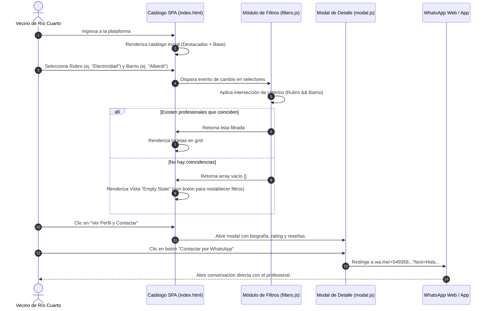
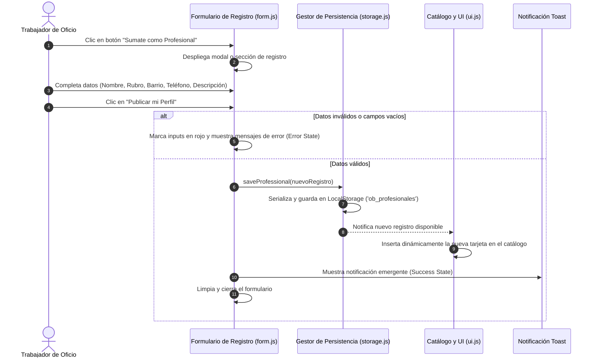
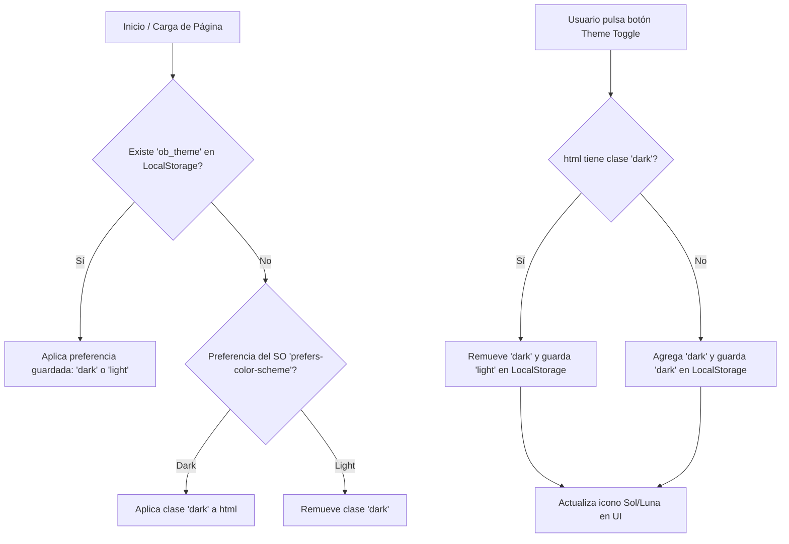

# Flujos de Usuario e Interacción del Sistema

Este documento describe los flujos operativos fundamentales de **Oficios Barriales - Impulso Barrial RIV S.A.S.** utilizando diagramas de secuencia y estados.

---

## 1. Flujo Principal: Búsqueda, Filtrado y Contacto vía WhatsApp

El vecino ingresa a la plataforma, filtra por necesidad geográfica y técnica, examina las credenciales del profesional y se comunica directamente.



---

## 2. Flujo de Registro: "Sumate como Profesional"

Permite a los trabajadores de oficios incorporarse a la plataforma de forma autónoma.



---

## 3. Flujo de Alternancia de Tema (Dark / Light Mode)



---

## 4. Matriz de Estados de la Interfaz (DoD)

```text
[Interacción / Evento]
       |
       +---> Transición asíncrona / Filtrado -----> ⏳ LOADING STATE (Skeleton / Spinner)
       |
       +---> Filtro sin coincidencias ------------> 📭 EMPTY STATE (Mensaje + Reset button)
       |
       +---> Formulario con datos inválidos ------> ⚠️ ERROR STATE (Bordes rojos + feedback)
       |
       +---> Registro exitoso / Acción OK --------> ✅ SUCCESS STATE (Toast flotante)
```
